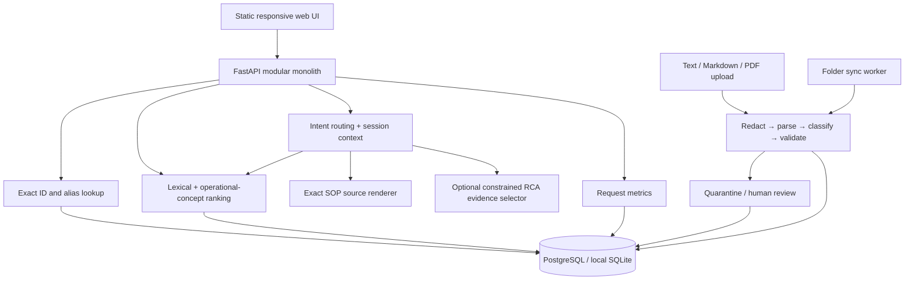

# Incident Atlas

A working RCA/SOP knowledge assistant for incident responders. It imports structured and legacy documents, versions them transactionally, distinguishes incident explanations from procedures, and returns inspectable source evidence.

**This is an assignment prototype, not a production-certified incident automation tool.** It never executes runbook commands. Sample procedures and incidents are synthetic fixtures.

## Start everything

With Docker Desktop's Linux engine running:

```sh
docker compose up --build --wait
```

Open **http://localhost:8000**. Interactive API documentation: **http://localhost:8000/docs**.

Compose starts PostgreSQL, the API/web UI, and the folder synchronization worker. Six verified example documents and four pending review records are imported automatically. PostgreSQL data persists in a named volume. Put Markdown/text documents in `knowledge/`; the worker picks up changes and deletions every ten seconds.

Copy `.env.example` to `.env` to configure the deployment. Set `SEED_DEMO=false` for your own corpus. Demo seeding is idempotent; it does not populate the watched folder. Both API and worker use the same PostgreSQL database.

### Local Python alternative

Python 3.13 or 3.14:

```sh
python -m pip install -r requirements-dev.txt
python run.py
```

This uses SQLite WAL at `data/knowledge.db`, binds only to `127.0.0.1`, and requires no model key. If dependencies have already been installed into `.deps/` in this workspace, `run.py` discovers them automatically.

The local folder worker is optional:

```sh
python -m backend.app.worker
```

Use an activated environment with installed requirements for the worker, or set `PYTHONPATH=.deps` when using workspace-local dependencies. On Windows, if sandbox restrictions block event-loop sockets, run from a normal terminal.

## Try it

1. Search `RCA-101`: exact identity lookup. Search `RCA-999`: no substitute.
2. Search `payments`: matching RCAs and SOPs are visibly labelled; close results trigger ambiguity messaging.
3. In **Incident assistant**, paste `payments API 503 database connection timeout`. Similar incidents and procedures appear in separate columns with matching evidence.
4. In **Document chat**, ask `Why did RCA-101 happen?`, then `What was the impact?`, then `SOP-101 steps`. The source type switches and the complete procedure is quoted.
5. In **Review queue**, inspect the mixed Redis source's separate RCA and SOP records. Incomplete procedures cannot be approved until the source is corrected and imported again.
6. Import a `.md`, UTF-8 `.txt`, or text-based `.pdf`. Scanned PDFs need external OCR. Unstructured/uncertain records stay quarantined.
7. View **Observability** for request latency, model calls, tokens, estimated model cost and status.

## Architecture



### Repository map

```text
backend/app/        API, store, ingestion, retrieval, chat, model gateway, worker
frontend/           Dependency-free HTML/CSS/JS web application
sample_data/        Synthetic greenfield and messy brownfield source fixtures
templates/          RCA and SOP authoring templates
knowledge/          Watched source folder, mounted read-only into the worker
tests/              Lifecycle, concurrency, isolation, API, model and sync tests
evaluation/         Development/regression datasets, runner and raw measurements
scripts/            Quality gate, browser smoke check, HTTP and scale benchmarks
docs/               UI screenshots and evidence notes
DESIGN.md           Data contracts, trade-offs, failure modes, cuts and next steps
```

## Document format and lifecycle

See `templates/rca.md` and `templates/sop.md`. Front matter is intentionally a **flat `key: value` subset**, not a general YAML parser. Important fields: `id`, `type`, `title`, `service`, `owner`, `environment`, `last_reviewed`.

- Source keys identify imported sources independently of titles. Explicit public IDs remain stable across edits.
- SHA-256 content hashes make repeated ingestion a no-op. PostgreSQL advisory transaction locks / SQLite `BEGIN IMMEDIATE` serialize mutations across processes. Unique constraints provide a second identity boundary.
- Versions are append-only. Only the current active version is queried, without a separate eventually consistent search index or result cache.
- Exact same-type, same-service content is canonicalized across names. Alternate public IDs resolve through aliases. A duplicate alias cannot overwrite the canonical document. Removing its canonical source transfers ownership to a remaining live source.
- An edit through the canonical source advances the shared canonical version. Aliases are references to that shared identity, not independent forks. To fork, remove the alias source and import changed content with a new ID.
- Near-duplicates are labelled in result sets using token Jaccard similarity; they are not automatically merged.
- Source removal hides its document when no other live alias source references it. Explicit revision numbers reject stale writes and stale resurrection; writers should supply monotonic revisions when syncing from a versioned upstream system.
- Mixed sources create linked RCA/SOP records with separate sections, both initially requiring review.
- Unresolved type is explicitly provisional inside review; it never appears as verified search evidence.
- Review decisions require the expected version, preventing approval of a concurrently changed document. Missing root cause or incomplete/misordered SOP steps are hard failures.

## Optional model integration

The default uses zero external model calls. Retrieval is lexical with a small operational synonym lexicon; **there is no trained embedding model or pgvector in this implementation**.

For an OpenAI-compatible chat-completions endpoint, configure environment variables:

```dotenv
ENABLE_LLM=true
LLM_BASE_URL=https://your-approved-provider.example/v1
LLM_API_KEY=your-key
LLM_MODEL=your-model
LLM_INPUT_USD_PER_MILLION=your-current-input-price
LLM_OUTPUT_USD_PER_MILLION=your-current-output-price
```

The optional model selects existing RCA section names using a JSON contract. The application validates those references and renders source excerpts itself. It cannot invent answer text or modify SOPs. Only pre-redacted input/evidence is sent, evidence payloads are capped, calls have a two-second socket timeout, and invalid/offline responses fall back to deterministic excerpts with a visible warning. A real provider/key was not used during local verification; model behavior is covered with mocked valid, invalid and unavailable responses. Price values are operator supplied, not hardcoded market estimates. Failed calls may have unknown billing.

## Security and operating boundaries

- Set `ADMIN_TOKEN` to require a bearer token for ingestion, deletion, reviews and metrics. The UI's **Admin access settings** keeps it in memory for the current tab only.
- **Read routes are workspace-wide.** There is no SSO, per-user authorization, tenant isolation or RBAC. Do not expose this demo publicly. Production requires an authenticated gateway plus document-level ACL filtering before retrieval and model use.
- Secret patterns, private IPv4 addresses and `.internal`/`.local`/`.corp` hostnames are redacted before persistence. Original unredacted bytes are never written. This is a heuristic detector, not comprehensive DLP; IPv6, unusual tokens and encoded secrets need stronger detectors.
- Redacted SOP steps are quarantined: the system does not present a damaged command as a ready-to-use procedure.
- Text from imported sources is rendered with DOM `textContent`, never injected as HTML. Model output only selects validated evidence keys. No tool execution is available to source documents or the model.
- HTTP metrics store route templates, counts and timings, not raw queries or request bodies. Conversation content is redacted, but still operational data: deploy retention/deletion and encryption policies before production use.
- The database is authoritative. When unavailable, API knowledge requests return 503 rather than fabricated evidence. The static UI can still load. Model outages preserve local retrieval/extractive answers. An unavailable source folder does not trigger document deletion.
- No separate index/cache means no stale index cleanup race. Already-rendered browser conversations are historical snapshots and are not remotely erased on source deletion. The next answer rechecks active evidence; production needs client invalidation and retention controls for stronger deletion guarantees.

## Verification and evidence

```sh
python scripts/check.py
python evaluation/run.py --split development
python scripts/benchmark.py --documents 3000 --queries 30
python scripts/smoke_http.py
```

`scripts/check.py` runs meaningful regression tests and the evaluation gate; any regression case failure exits nonzero. CI uploads raw evidence on success or failure. The initial holdout run exposed legacy title extraction and an unsafe generic match; `evaluation/results/initial-holdout-*` preserves those failures. They were fixed, and the partition is now **reused regression data**, not a fresh blind estimate. Development and held-out case files are separate, but both are synthetic author-created data. The assignment mentions provided queries; none were supplied in this workspace.

Results include greenfield/brownfield and per-operation breakdowns, raw answers, request cost, latency and Wilson intervals. Related cases and the small corpus mean those intervals should not be read as production confidence. Brownfield reviewed cases include explicit simulated fixture-owner approvals; pre-review quarantine is tested separately. Model cost zero in local mode means zero external token charges, **not zero hosting or engineering cost**.

Browser smoke verification:

```sh
npm install --no-save playwright
npx playwright install chromium
node scripts/browser_smoke.cjs
```

Use `ATLAS_BROWSER_CHANNEL=msedge` to use installed Edge, or `PLAYWRIGHT_MODULE` for an existing Playwright package. Screenshots are saved under `docs/`.

See `docs/VERIFICATION.md` for what actually ran in this workspace, including Docker/production verification limits. See `DESIGN.md` for cuts and the next implementation priorities.
